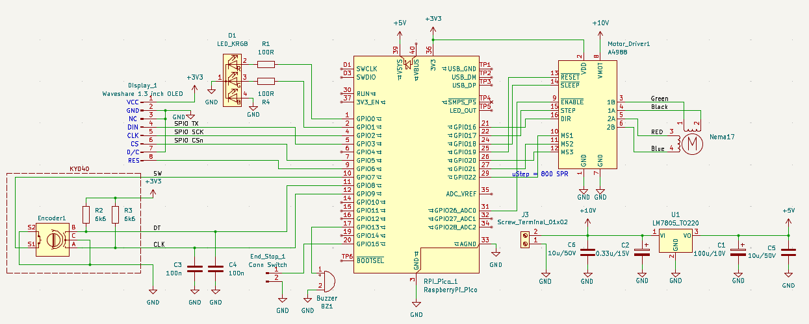

# Stepper-position-indicator

## Členové týmu
* Jiří Vocilka -
* Ondřej Chmela -
* Martin Kovář -
* Matěj Nachtnebel -

## Popis problému a shrnutí řešení

Tento projekt řeší přesné vizuální zobrazování polohy pomocí krokového motoru.

* **Nastavení cílové polohy:** Otáčením rotačního enkodéru uživatel nastavuje požadovanou cílovou pozici.
* **Zapnutí a vypnutí ovladače motoru:** Dlouhým stiskem tlačítka na enkodéru se vypne/zapne ovladač motoru. Při změně zazní tón.
* **Změna rychlosti:** Krátkým stiskem tlačítka na enkodéru se změní rychlost pohybu motoru.
* **Řízení motoru:** Krokový motor automaticky otáčí fyzický ukazatel na nově nastavenou polohu.
* **Zobrazení dat na displeji:** Na displeji se v reálném čase zobrazuje aktuální a cílová poloha včetně stavových informací.
* **Nulování referenční polohy:** Stiskem mikrospínače se kalibruje nulová pozice pro přesné odměřování.
* **Stavová indikace:** RGB LED dioda vizuálně signalizuje provozní stavy systému (pohyb motoru, dosažení cíle, nulování).
  * Červená bliká -> Ovladač motoru vypnutý
  * Zelená -> Nejnižší rychlost
  * Žlutá -> Střední rychlost
  * Oranžová -> Nejvyšší rychlost

## List komponent

| Množství | Komponenta | Popis / Funkce |
| :---: | :--- | :--- |
| 1x | Raspberry&nbsp;Pi&nbsp;Pico&nbsp;W | Řídicí mikrokontrolér (mozek celého systému), zpracovává vstupy a řídí ostatní komponenty. |
| 1x | Nema&nbsp;17 | Krokový motor – automaticky otáčí fyzický ukazatel na nově nastavenou polohu. |
| 1x | A4988 | Motor driver – obvod sloužící k řízení krokového motoru. |
| 1x | Waveshare&nbsp;1.3&nbsp;inch | Displej – v reálném čase zobrazuje aktuální a cílovou polohu včetně stavových informací. |
| 1x | ky-040 | Rotační enkodér – jeho otáčením uživatel nastavuje požadovanou cílovou pozici. |
| 1x | Mikrospínač | Nastavení počátku (re-zero) – stiskem se kalibruje nulová pozice pro přesné odměřování. |
| 1x | RGB&nbsp;Led | Stavová indikace – vizuálně signalizuje provozní stavy systému (pohyb motoru, dosažení cíle, nulování). |
| 1x | Bzučák HW-508 | Zvuková indikace – zaznění tónu při změně stavu motoru|

## Časování

| Část systému | Jak se spouští | Jak často běží | Co přesně dělá |
| :--- | :--- | :--- | :--- |
| **Enkodér (otáčení)** | Přerušení (`IRQ`) | Okamžitě při otočení | Hned zaznamená změnu polohy, aby se neztratil žádný krok. |
| **Krokový motor** | Asynchronní úloha | 125 Hz až 1000 Hz (pauza 8–1 ms) | Otáčí motorem na cílovou polohu s plynulým rozjezdem. |
| **Tlačítka** | Opakovaná kontrola | 100 Hz (každých 10 ms) | Kontroluje stisk enkodéru (rychlost / vypnutí) a mikrospínač nuly. |
| **OLED displej** | Opakovaná kontrola | ~6,7 Hz (každých 150 ms) | Překreslí údaje na obrazovce, ale jen když se nějaká hodnota změnila. |
| **RGB LED dioda** | Opakovaná kontrola | 10 Hz (každých 100 ms) | Svítí podle zvolené rychlosti, nebo bliká červeně (500 ms), když je motor vypnutý. |
| **Bzučák** | Opakovaná kontrola | 50 Hz (každých 20 ms) | Pípne při zapnutí nebo vypnutí motoru. |

## Blokový diagram

## Schéma zapojení

## Testování a ověření

Před finálním sestavením byly jednotlivé moduly otestovány samostatně pomocí skriptů ve složce [`tests`](./tests):

### 1. Stavová indikace ([RGB LED](./tests/RGB_LED.py))
- **Zapojení a funkčnost:** Ověřena správná polarita (společná katoda na `GND`) a reakce všech barevných kanálů.
- **PWM stavy:** Otestováno plynulé míchání barev pro jednotlivé rychlosti (zelená – nízká, žlutá – střední, oranžová – vysoká) i červené blikání (500 ms) při vypnutém motoru.

### 2. Zvuková signalizace ([Pasivní bzučák](./tests/buzzer.py))

